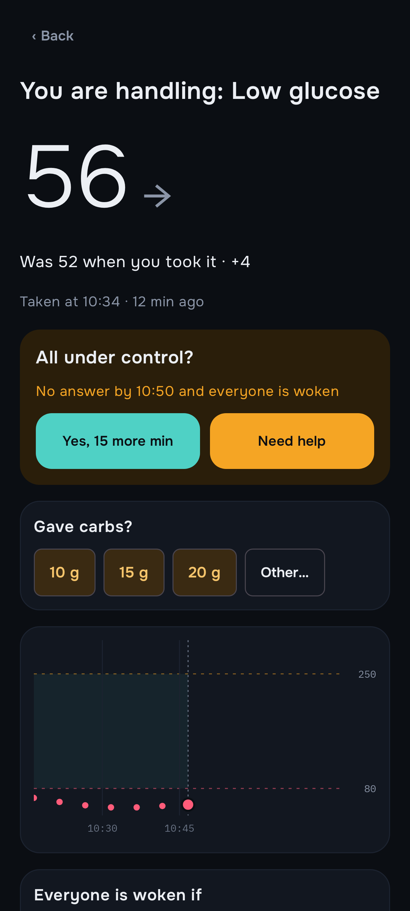
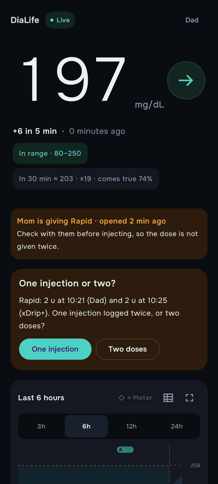
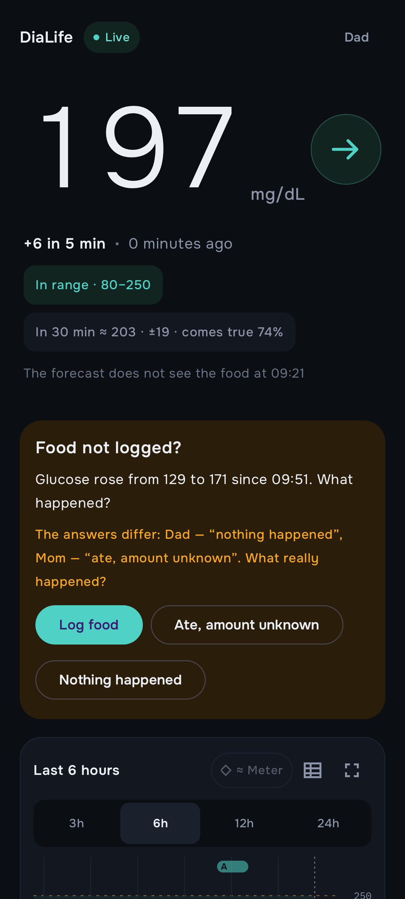
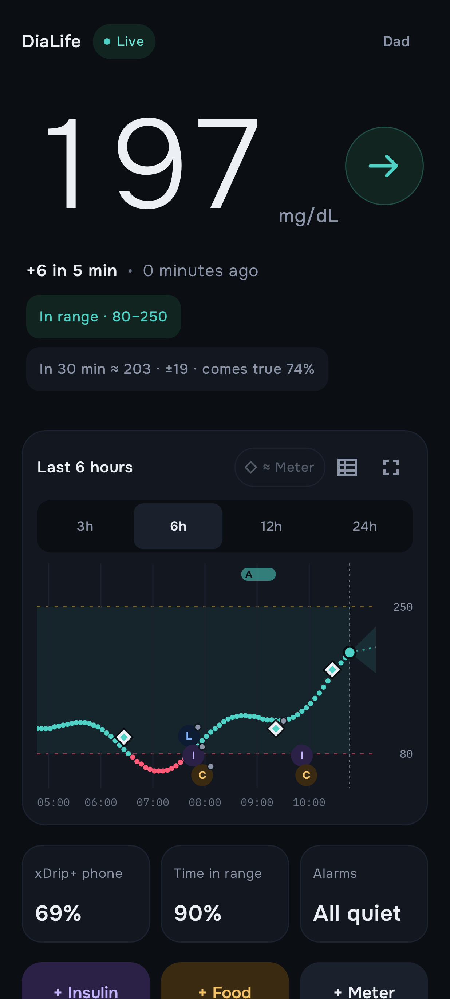
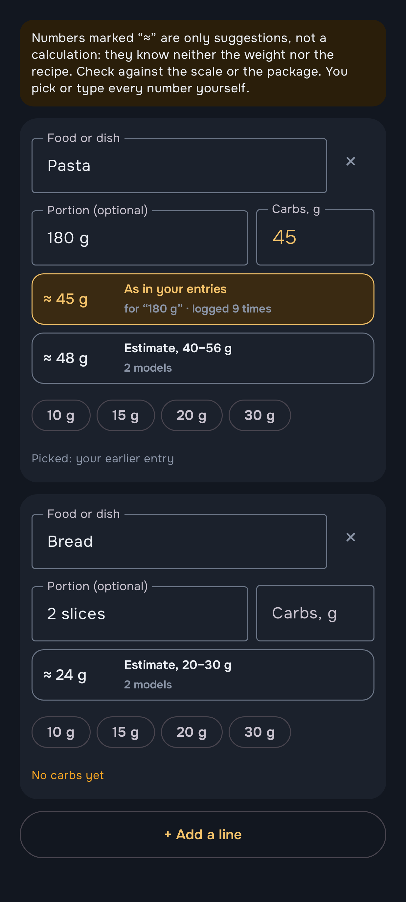
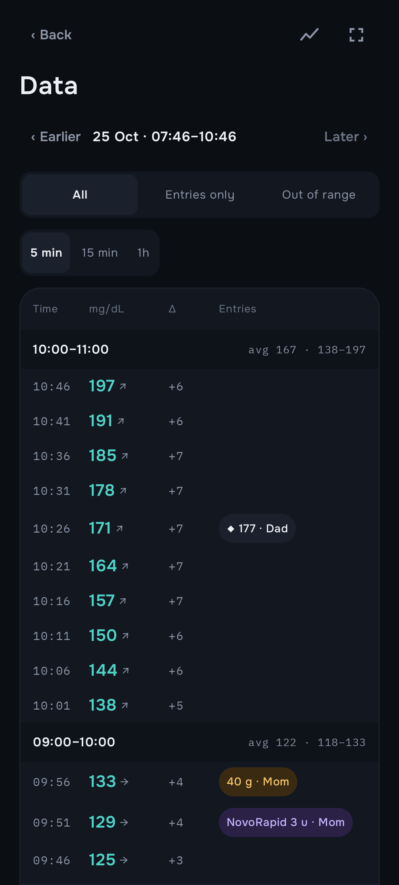
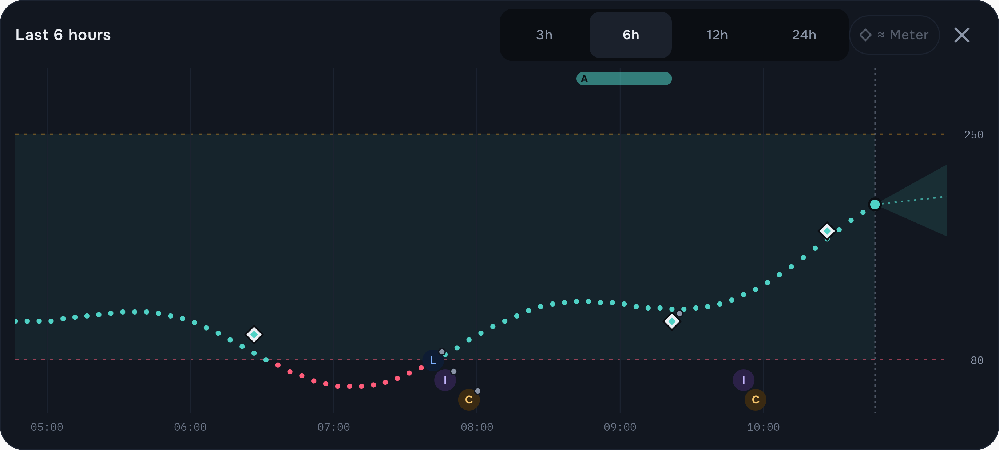
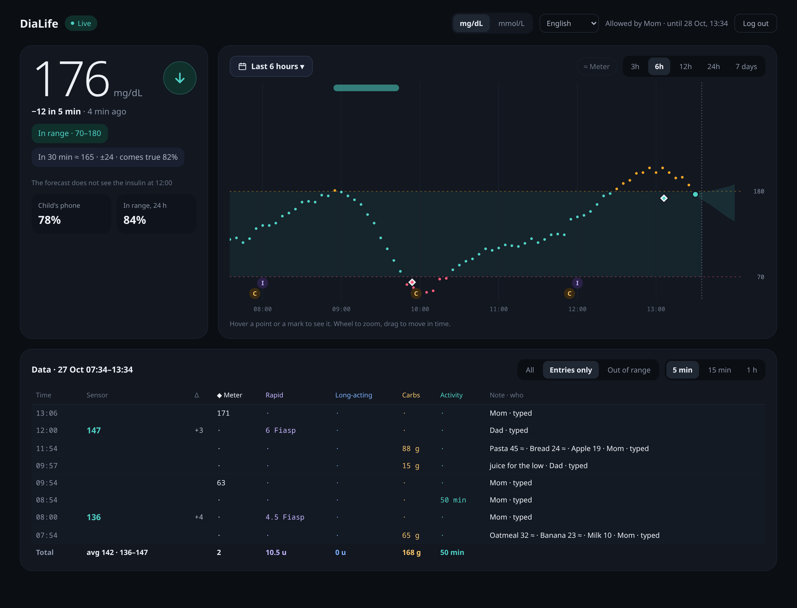

# DiaLife

> **Not a medical device. No warranty, no liability.** Read the
> [disclaimer](DISCLAIMER.md) before using any part of this project.

DiaLife relays a child's continuous glucose readings to the parents' phones
and makes sure somebody actually reacts to an alarm.

```
Dexcom sensor → xDrip+ (the child's phone) → DiaLife server → parents' Android app
                                                           ↘ read-only web viewer
                                                           ↘ ntfy (optional push)
```

It is a small, self-hosted alternative to running a full Nightscout: one Go
binary with SQLite behind your own HTTPS reverse proxy, an Android app for
each parent and a read-only web page. The interface is in Ukrainian, English
and Spanish.

<table>
  <tr>
    <td align="center" width="33%"><br><b>One parent takes the alarm</b><br>the others go quiet; nobody answering wakes everyone</td>
    <td align="center" width="33%"><br><b>No double insulin</b><br>who is injecting now, and "one injection or two?"</td>
    <td align="center" width="33%"><br><b>"Did you forget to log?"</b><br>asked until the parents' answers agree</td>
  </tr>
  <tr>
    <td align="center"><br><b>Live on every parent's phone</b><br>trend, forecast and how often it comes true</td>
    <td align="center"><br><b>Carb suggestions</b><br>the family's own numbers first</td>
    <td align="center"><br><b>Everything as a table</b><br>every reading and entry, by the hour</td>
  </tr>
</table>

<p align="center">
  
</p>
<p align="center">
  
</p>

The pictures are rendered from made-up data (`android/…/ReadmeShots.kt` for
the app; a demo server with a generated day for the web).

## What it does

- **Live glucose** on every parent's phone: a home screen with trend, forecast
  cone and a pinch-to-zoom chart, a full-screen landscape chart, home-screen
  and lock-screen widgets, and the same data as a table.
- **Alarm episodes, not just beeps.** Low, urgent low, high, urgent high,
  predicted low and "no data". One parent taps "I'm on it" and the others go
  quiet. Everyone is woken again if it gets worse, if nobody answers a check-in,
  if it lasts too long or if the one handling it asks for help.
- **Treatments.** Rapid and long-acting insulin, food, glucometer checks,
  activity and notes, entered from any phone (also offline) or synced from
  xDrip+. A reminder an hour before a scheduled long-acting dose.
- **No double insulin.** When a parent opens the insulin form, the other
  phones show "Mom is giving insulin". Saving a dose close to another one asks
  first: the same injection or a new one (rapid within 20 minutes), a
  correction (rapid within 3 hours), a second long-acting dose (within 16
  hours). A dose from xDrip+ that lands next to another asks every parent
  "one injection or two?", and "two" keeps a watch for a low.
- **Meals as a list, with carb suggestions.** Each food gets its own carbs.
  Suggestions come from the family's own earlier entries first and, if you
  configure one or more language models (Gemini, or any OpenAI-compatible API:
  OpenAI, OpenRouter, a local Ollama), from their estimate with a range. A
  suggestion is only ever a tap away, never filled in by itself. Without a
  model configured nothing about food leaves the server.
- **"Did you forget to log?"** A rise with no food or a fall with no insulin
  asks every parent what happened, and asks again until their answers agree.
  Unanswered questions become marks on the chart.
- **Sensor vs glucometer.** Pairs every glucometer check with the sensor at
  that moment and estimates, sensor by sensor, how far apart the two usually
  are. With enough checks an optional "≈ meter" line appears on the chart.
- **Statistics.** Time in range, mean, GMI, CV, the typical day (AGP), daily
  insulin and carbs, and an alarm log. The 30-minute forecast shows how often
  it came true on the child's own recent readings.
- **Read-only web viewer** for a computer: the chart, any period, and every
  reading and entry as a table. A browser gets in only when a parent scans its
  QR code in the app and chooses how long it may stay; the parent can end the
  session from the phone at any time.
- **Nightscout-compatible upload API**, so xDrip+ uploads to it as it would to
  Nightscout.

## Repository

| Path | What |
|---|---|
| `cmd/dialife`, `internal/` | the server (Go, SQLite with migrations) |
| `android/` | the parents' app (Kotlin, Jetpack Compose) |
| `deploy/` | systemd units, Caddy snippets, deploy and backup scripts |
| `tools/dl` | the admin tool: runs every command on the server over SSH |
| `testdata/` | sample xDrip+ uploads used by the tests |

## Requirements

- **Server:** a small Linux server with systemd and SSH access as root, and
  [Caddy](https://caddyserver.com) (or another reverse proxy) for HTTPS on your
  own domain. DiaLife uses about 20 MB of RAM.
- **To build:**
  - Go 1.27 for the server.
  - JDK 21 and the Android SDK for the app (API 36, runs on Android 12+).
  - `python3` and `qrencode` for `tools/dl`.
- **xDrip+** on the phone that reads the sensor.

## Setting it up

### 1. Your settings

Nothing about your installation is stored in the repository. Two files hold it:

```sh
# on your computer: where the server is, domains, Caddy, ntfy topics
cp deploy/dialife.conf.example deploy/dialife.conf     # git-ignored
$EDITOR deploy/dialife.conf

# on the server: secrets, public URL, time zone, the name of the xDrip+ phone
scp deploy/dialife.env.example root@your-server:/etc/dialife.env
ssh root@your-server 'chmod 600 /etc/dialife.env && $EDITOR /etc/dialife.env'
```

Then put `tools/dl` on your `PATH`: `ln -s "$PWD/tools/dl" ~/.local/bin/dl`.

### 2. Server

```sh
dl deploy                 # tests, builds, uploads the binary and systemd units, restarts
deploy/caddy-add.sh       # one time: adds the site block to your Caddyfile, validates, reloads
```

`deploy/caddy-add.sh` backs up the Caddyfile first and puts it back if the
result does not validate. Only `/api/*` and the web viewer (`/`, `/web/*`)
are exposed; everything else is refused.

### 3. Devices

Every phone gets its own token. A revoked token stops working at once.

```sh
dl device-add "xDrip" uploader            # prints the token for xDrip+
dl device-add "Mom" caregiver --qr        # a QR code to scan in the app
dl device-add "Dad" caregiver --qr
dl devices                                # list; dl revoke ID to cut one off
```

If one person uses several phones, `dl device-person ID NAME` makes them
answer questions as one person.

### 4. xDrip+

In xDrip+: **Settings → Cloud Upload → Nightscout Sync (REST-API)**. Turn it
on and set the Base URL to

```
https://<xDrip token>@dialife.example.com/api/v1/
```

Enable uploading treatments if you want entries made in xDrip+ to show up in
the app, and downloading them if you want the parents' entries to show up in
xDrip+.

Phone makers' battery savers are the most common reason readings stop
arriving. On the xDrip+ phone, exempt xDrip+ from battery optimisation,
allow it to run in the background, and turn off any "sleep" or "deep
optimisation" mode.

### 5. The app

```sh
cd android
./gradlew assembleRelease        # or: dl app  (tests, builds, installs on every phone on USB)
```

Or download a ready APK from [Releases](https://github.com/varunok/dialife/releases).

Install the APK, open it and scan the QR code from `dl device-add … --qr`.
Then allow notifications, alarms over the lock screen and unrestricted battery
use, as the app asks. An APK you build yourself is signed with your local debug
key unless you put your own key in `.local/keys/release.properties` (see
`android/app/build.gradle.kts`). The APKs on Releases are signed with the
project's key, so yours will not install over them, nor theirs over yours.

### 6. Optional: push through ntfy

With a self-hosted [ntfy](https://ntfy.sh), the server also sends alarms as
push notifications with action buttons. Set `DIALIFE_NTFY_URL`,
`DIALIFE_NTFY_TOKEN` and `DIALIFE_NTFY_TARGETS` in `/etc/dialife.env`. The
`deploy/ntfy.Caddyfile.snippet` exposes ntfy on its own domain:
`deploy/caddy-add.sh deploy/ntfy.Caddyfile.snippet ntfy`.

### 7. Optional: carb estimates

Add one or more models to `/etc/dialife.env` and redeploy; each comma-separated
model is asked at the same time, each with its own timeout, and their answers
are combined (the middle number, the widest range). An answer is cached per
food and portion. With none set, the app only suggests the family's own
earlier numbers.

```sh
DIALIFE_GEMINI_KEY=…                       # from aistudio.google.com (not the Gemini app subscription)
DIALIFE_GEMINI_MODEL=gemini-3.5-flash-lite
DIALIFE_OPENAI_URL=https://openrouter.ai/api/v1   # or OpenAI, or http://127.0.0.1:11434/v1 for Ollama
DIALIFE_OPENAI_KEY=…
DIALIFE_OPENAI_MODEL=…
DIALIFE_LLM_TIMEOUT=10s
```

Only the food names and portions are sent, never glucose or names. They are
estimates of a language model: check them against the package or the scale.

### 8. The web viewer

Nothing to set up beyond the Caddy block above: open your domain in a
browser, then in the app **⋮ → Web login** and scan the code.

### 9. Backups

The server makes a daily SQLite backup (`dialife-backup.timer`). The user
units in `deploy/laptop/` pull those backups to your computer every hour over
a read-only SSH key. Copy `deploy/laptop/pull.env.example` to
`~/.config/dialife/pull.env` before you enable them.

## Daily use

```sh
dl status                 # services, versions, memory, age of the newest reading, live alarms
dl last                   # newest readings
dl alarms                 # thresholds and live episodes
dl set low=70 high=180    # change thresholds (takes effect within a minute)
dl logs -f                # follow the server log
dl help                   # everything else
```

## Development

```sh
make test                                   # server: go vet + tests
cd android && ./gradlew testDebugUnitTest   # app: unit tests
./gradlew verifyRoborazziDebug              # app: screenshots against src/test/screenshots
./gradlew recordRoborazziDebug              # accept changed screenshots
./gradlew recordRoborazziDebug --tests '*ReadmeShots*'   # re-render the README pictures (docs/screenshots)
```

## License

[MIT](LICENSE). The bundled fonts (Onest, IBM Plex Mono) are under the SIL Open
Font License; see `android/licenses/`. The web viewer bundles
[Mithril](https://mithril.js.org) (MIT, `internal/web/static/mithril.LICENSE.txt`).

xDrip+, Dexcom, Nightscout and ntfy belong to their respective owners. DiaLife
is not affiliated with or endorsed by any of them.
